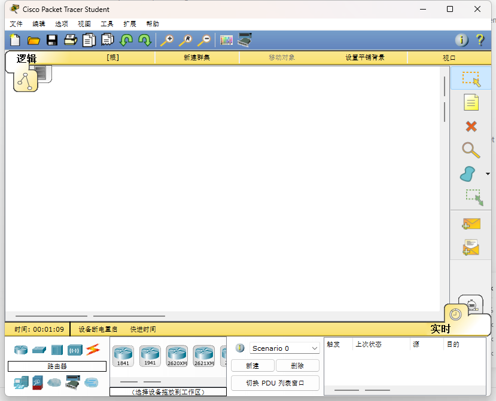

# Cisco Packet Tracer 6.2 Student 简体中文语言包

适用于 **Cisco Packet Tracer 6.2 Student Version** 的非官方简体中文语言包。它通过 Packet Tracer 自带的语言选择功能加载，不修改程序的 EXE 或 DLL。已在 Windows 上的 `Cisco Packet Tracer 6.2sv` 安装目录中验证；其他版本尚未验证。



## 下载

下载本仓库的 ZIP，解压后保留以下文件在同一个目录：

```text
chinese-zh_CN.ptl
install.ps1
安装中文补丁（双击我）.cmd
```

语言包 `chinese-zh_CN.ptl` 的 SHA-256 为：

```text
7A587F4A054CB8BEDA806E9E821FAC24B6766675A7858BDD9916405A1F29B802
```

## 安装

### 自动安装

在 Windows 中双击 `安装中文补丁（双击我）.cmd`。脚本会查找名为 `Cisco Packet Tracer 6.2sv` 的安装目录，并请求管理员权限，将语言包复制到该目录的 `languages` 文件夹。安装前可阅读仓库中的 `install.ps1`。

### 手动安装

把 `chinese-zh_CN.ptl` 复制到 Packet Tracer 的 `languages` 目录。默认安装路径为：

```text
C:\Program Files (x86)\Cisco Packet Tracer 6.2sv\languages\
```

复制到 `Program Files` 通常需要管理员权限。

### 在程序中启用

1. 打开 Packet Tracer，进入 **Options → Preferences → Interface**。
2. 在 **Select Language** 中选择 `chinese-zh_CN.ptl`，点击 **Change Language** 并确认。
3. 完全退出 Packet Tracer，再重新启动。语言会在下次启动时生效。

## 恢复英文或卸载

在 **Options → Preferences → Interface** 中选回 `default.ptl`，点击 **Change Language**，完全退出并重启。确认英文界面恢复后，可删除 `languages\chinese-zh_CN.ptl`。无需修改 `default.ptl`。

## 兼容性与说明

- 仅针对 **Packet Tracer 6.2 Student Version**。Packet Tracer 7、8 等版本的语言资源可能不同，请勿直接使用。
- 语言包由 Qt 翻译资源编译而来；`.ptl` 使用 Qt `.qm` 格式。少量由程序动态生成或保留为命令、协议缩写的文本可能继续显示英文。
- 仓库不包含 Cisco Packet Tracer 安装程序、可执行文件、DLL 或官方英文语言包。请自行从合法渠道获取 Packet Tracer。
- 这是非官方个人翻译项目，与 Cisco 无关联。Cisco、Packet Tracer 及其相关商标和原始界面文本归各自权利人所有。本仓库未对相关第三方内容授予开源许可。

## 文件

| 文件 | 用途 |
| --- | --- |
| `chinese-zh_CN.ptl` | 安装到 `languages` 目录的最终语言包 |
| `install.ps1`、`安装中文补丁（双击我）.cmd` | Windows 安装入口 |
| `preview.png` | 在 Packet Tracer 6.2 Student 上的界面截图 |

发现翻译问题时，请附上原文、出现位置和建议译法。
